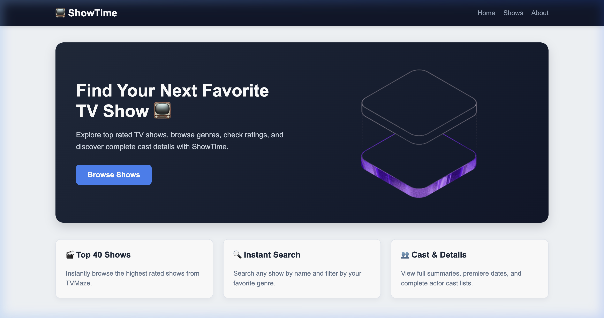

# PS6: ShowTime - TV Show Finder

A modern TV show explorer web application built with **React**, **React Router**, and the **TVMaze API**.

---

## 📋 Problem Statement Details

- **PS Number:** PS6
- **Project Name:** ShowTime: TV show finder
- **Course Assignment:** Assignment-5
- **API Used:** [TVMaze REST API](https://www.tvmaze.com/api) (Free, no API key required)
  - Shows List: `https://api.tvmaze.com/shows?page=0`
  - Show Details: `https://api.tvmaze.com/shows/:id`
  - Show Cast: `https://api.tvmaze.com/shows/:id/cast`
  - Show Search: `https://api.tvmaze.com/search/shows?q=:query`

---

## 🌐 Live Link

- **Live Deployment:** [https://ps6-showtime.vercel.app](https://ps6-showtime.vercel.app)  
  *(Update this with your own Vercel/Netlify deployment URL)*

---

## 🛣️ Routes

| Route | Page / Component | Description |
| :--- | :--- | :--- |
| `/` | `Home.jsx` | Hero banner with call-to-action "Browse Shows" button and feature highlights |
| `/shows` | `Shows.jsx` | First 40 shows displayed as cards with posters, title, genres, rating, controlled search filter, and genre dropdown |
| `/shows/:id` | `ShowDetails.jsx` | Dynamic route using `useParams` showing poster, title, genres, language, premiere date, rating, clean summary, and full cast list |
| `/about` | `About.jsx` | Project overview, technical specifications, and API documentation |
| `*` | `NotFound.jsx` | Custom 404 "Page Not Found" with a button to return Home |

---

## 📸 Screenshots

### 1. Home Page (Hero Section)


### 2. Shows Explorer (Cards, Search, & Filters)


### 3. Show Details & Cast List


---

## ✨ Features

- **Dynamic Routing:** Built using `react-router` with dynamic parameters (`:id`) and fallback 404 routing.
- **Data Fetching:** Handled via `useEffect` and `fetch` with dedicated loading indicators and error recovery states.
- **Controlled Search:** Real-time client-side filter with input state and bonus full TVMaze search integration.
- **Genre & Sort Filters:** Category dropdown filter (Action, Drama, Comedy, Sci-Fi, etc.) and rating/name sorting.
- **Component Architecture:** Clean separation into modular components (`Navbar`, `Home`, `Shows`, `ShowDetails`, `ShowList`, `ShowCard`, `SearchBar`, `Filters`, `About`, `NotFound`).
- **Responsive UI:** CSS Grid and Flexbox layouts designed for desktop, tablet, and mobile screens.
- **Vercel SPA Routing:** Includes `vercel.json` rewrite configuration so direct URL visits and page refreshes work without 404 errors.

---

## 🛠️ Tech Stack

- **React 19**
- **React Router 8**
- **Vite 8**
- **Vanilla CSS**

---

## 🚀 Getting Started Locally

1. **Clone the repository:**
   ```bash
   git clone https://github.com/<your-username>/ps6-showtime.git
   cd ps6-showtime
   ```

2. **Install dependencies:**
   ```bash
   npm install
   ```

3. **Start the local development server:**
   ```bash
   npm run dev
   ```

4. **Build for production:**
   ```bash
   npm run build
   ```
